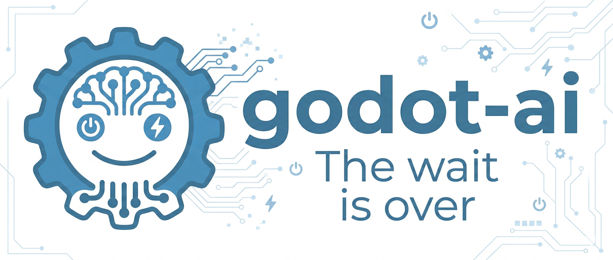
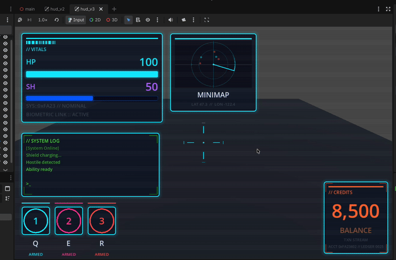
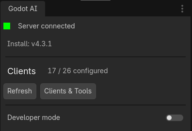
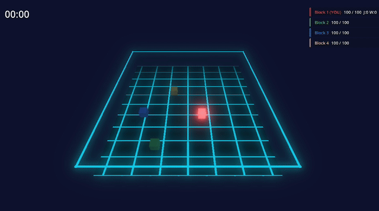

<p align="center">
  
</p>

# Godot AI

[](https://github.com/hi-godot/godot-ai/actions/workflows/ci.yml)
[](https://codecov.io/gh/hi-godot/godot-ai)
[](https://discord.gg/FDZ5fr2QkP)

**Godot AI connects Claude Code, Codex, Cursor, and other
[MCP](https://modelcontextprotocol.io/introduction) clients to a live Godot
editor.** Its [46 tools and 120+ operations](docs/TOOLS.md) build scenes, edit
nodes and scripts, wire signals, and configure UI, materials, animation,
particles, cameras, and environments.

**21,000+ monthly active installs · 30M+ tool calls in the last three months · 3,200+ GitHub stars**
<br><sub>Install and tool-call counts come from anonymous telemetry and exclude opted-out installs: the 30 days, and July 27 onward, to October 25, 2026.</sub>

<p align="center">
  <br>
  <em>Built in ~2 hours with Godot AI, without hand-written code or image generation — <a href="https://github.com/hi-godot/cyberpunk-hud-demo">source</a></em>
</p>

## Quick start

You need **Godot 4.7+**, [uv](https://docs.astral.sh/uv/getting-started/installation/)
(it runs the Python server), and an MCP client.

1. **Install uv** (once):
   - macOS/Linux:
     ```sh
     curl -LsSf https://astral.sh/uv/install.sh | sh
     ```
   - Windows (PowerShell):
     ```powershell
     irm https://astral.sh/uv/install.ps1 | iex
     ```
2. **Install the add-on** from the Asset Store (Godot's **AssetLib** tab), or
   from a [GitHub release](https://github.com/hi-godot/godot-ai/releases) into
   `your-project/addons/godot_ai/`.
3. **Enable it:** **Project → Project Settings → Plugins → Godot AI**.
4. **Connect your client:** in the **Godot AI** dock, press **Configure** next
   to your client, or **Configure all**. Restart the client if it doesn't
   notice the change.

<p align="center">
  
</p>

**Already installed?** Click **Update** in the dock. Never extract a new
version over an existing `addons/godot_ai/`. From v3, the same button migrates
you to v4 ([migration guide](docs/v4-migration.md)).

<details>
<summary><strong>Supported clients and exceptions</strong></summary>

The dock configures 26 clients, including Claude Code, Claude Desktop, Codex,
Cursor, VS Code, Antigravity, Gemini CLI, and Hermes Agent, and shows a
**Run this manually** command for the rest.

- Use the dock-generated command: it pins the matching version, ports, and
  tool domains. v4 clients connect through `godot-ai attach` over stdio; a bare
  `http://127.0.0.1:8000/mcp` entry cannot authenticate.
- Updates repin owned client entries automatically. The default scope is
  global, so this also redirects other projects still on an older version;
  update them too. Reconfigure after changing ports, telemetry preferences, or
  tool domains.
- Pi Coding Agent needs an MCP extension that reads `~/.pi/agent/mcp.json`.
  Cherry Studio is not supported in v4; remove stale v3 entries in Cherry
  Studio itself.

Details: [client configuration](docs/client-configuration.md).

</details>

<details>
<summary><strong>Per-project configuration</strong></summary>

CLI-configured clients default to global `user` scope. Set **Editor Settings →
Plugins → `godot_ai/mcp_client_scope`** to `project` (or `local`, where supported),
then press **Configure** again.

**Configure** removes existing `godot-ai` entries from every scope before
writing the selected one. This can modify a checked-in `.mcp.json`, but does not
touch other server entries. **Remove** affects only the selected scope.

Launch Godot from the project directory so the client CLI writes configuration
in the right place. Claude Code also requires one-time approval from `claude`
run inside that project.

</details>

<details>
<summary><strong>GDScript and C#</strong></summary>

GDScript is fully supported: scripts are parse-validated, hot-reloaded,
attached, and outlined. C# is **text-only**: `script_create` / `script_patch`
write `.cs` files and `script_manage(op="find_symbols")` outlines them, but
Godot AI does not build .NET or report compiler errors. Attaching a `.cs` needs
a .NET-enabled editor build. [C# support](docs/TOOLS.md#c-support).

</details>

### Try it

- *"Show me the current scene hierarchy."*
- *"Create a Camera3D named MainCamera under /Main."*
- *"Run the scene test suite."*
- *"Build a voxel block-world game with a player, blocks to place and destroy, and save slots."*

<p align="center">
  <br>
  <em>A block-world game with a save system, built from a handful of prompts — <a href="https://github.com/dsarno/save-system-godot-claude">source</a></em>
</p>

## Security

Godot AI has prioritized security from the start. Today that includes:

- **Signed releases.** The in-editor updater verifies the signature and every
  file before it installs anything.
- **Authenticated local connections.** The server and the editor accept only
  connections that present rotating credentials, and the editor connection is
  loopback-only.
- **Project confinement.** Writes stay inside your project, and
  `project.godot`, `override.cfg`, and `.godot/` are off-limits.
- **A guarded release pipeline.** Pinned dependencies, qualification on Linux,
  macOS, and Windows, and a human approval before anything is published.
- **Open disclosure.** Vulnerabilities are fixed and published as
  [security advisories](https://github.com/hi-godot/godot-ai/security/advisories).

**Update promptly.** 4.3.1, for example, removes the emSign root certificates
compromised in October 2026.

That said, attacks on open-source supply chains are increasing, and more critical
vulnerabilities will appear in Godot AI, its dependencies, and the tools
around it. Following advisories and the wider security landscape is your
responsibility. Godot AI is MIT-licensed open source, provided as is; you use
it at your own risk.

<details>
<summary><strong>How it works</strong></summary>

```text
MCP client
  → godot-ai attach (stdio)
  → Python server (authenticated HTTP, port 8000)
  → Godot editor plugin (authenticated WebSocket, port 9500)
```

Both local hops use independent rotating capabilities; neither falls back to
unauthenticated access, and the editor WebSocket stays loopback-only. These
controls do not protect against a compromised same-user process, and Windows
does not claim isolation from other local accounts. See the
[security model](docs/plugin-architecture.md#security-model),
[package trust boundaries](docs/packaging-distribution.md), and
[agents on another machine or in a container](docs/client-configuration.md#agents-on-another-machine-or-in-a-container).

</details>

## Privacy

Anonymous telemetry records an installation UUID, event, outcome, duration,
platform, and version, never code, scene contents, or project or file names.
Opt out with `GODOT_AI_DISABLE_TELEMETRY=true` or `DISABLE_TELEMETRY=true`, or
in the editor. [Details](docs/TELEMETRY.md).

## Docs and help

- [Tools, operations, and resources](docs/TOOLS.md) ·
  [Write and run tests for your game](docs/testing.md) ·
  [Community addons and custom tools](docs/community-addons.md)
- [Upgrading from v3](docs/v4-migration.md) ·
  [Linux troubleshooting](docs/troubleshooting-linux.md) (Bazzite, Steam, Flatpak) ·
  [Changelog](CHANGELOG.md)
- [Contributing](docs/CONTRIBUTING.md) ·
  [Discord](https://discord.gg/FDZ5fr2QkP) for questions and showcases ·
  [GitHub Issues](https://github.com/hi-godot/godot-ai/issues) for bugs

## Star History

<!-- Generated by .github/workflows/star-history.yml on the star-history branch. -->
<a href="https://github.com/hi-godot/godot-ai/stargazers">
  
</a>

**License:** [MIT](LICENSE)
